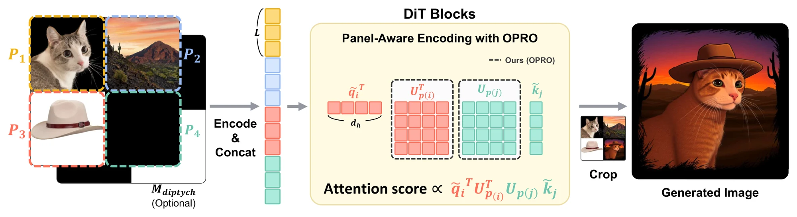
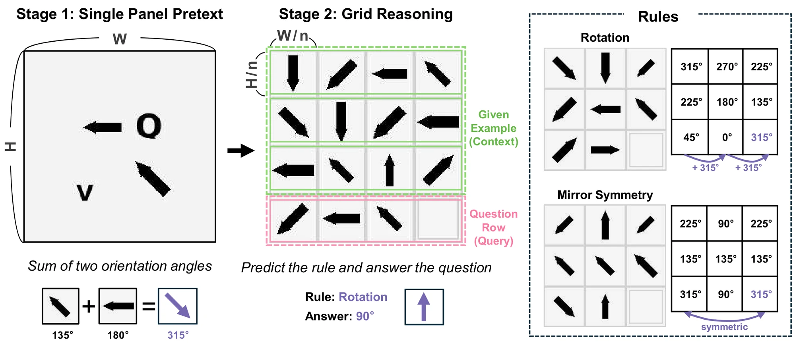

# OPRO: Orthogonal Panel-Relative Operators

[](https://openaccess.thecvf.com/content/CVPR2026/html/Lee_OPRO_Orthogonal_Panel-Relative_Operators_for_Panel-Aware_In-Context_Image_Generation_CVPR_2026_paper.html)
[](https://arxiv.org/abs/2603.27637)
[](https://niceduckgu.github.io/OPRO/)
[](LICENSE)

Official code for **OPRO: Orthogonal Panel-Relative Operators for Panel-Aware In-Context Image Generation** (CVPR 2026).

Sanghyeon Lee, Minwoo Lee, Euijin Shin, Kangyeol Kim, Seunghwan Choi, Jaegul Choo<br>
Korea Advanced Institute of Science and Technology (KAIST)

[Paper](https://openaccess.thecvf.com/content/CVPR2026/html/Lee_OPRO_Orthogonal_Panel-Relative_Operators_for_Panel-Aware_In-Context_Image_Generation_CVPR_2026_paper.html) · [arXiv](https://arxiv.org/abs/2603.27637) · [Supplementary](https://openaccess.thecvf.com/content/CVPR2026/supplemental/Lee_OPRO_Orthogonal_Panel-Relative_CVPR_2026_supplemental.pdf) · [Project page](https://niceduckgu.github.io/OPRO/)



OPRO is a parameter-efficient adapter for tiled-panel in-context generation with diffusion
transformers. It learns one orthogonal operator per panel and applies it to the position-aware
queries and keys of that panel. The attention logit between tokens `i` and `j` then contains the
relative operator `U_p(i)^T U_p(j)`, which gives two exact properties.

- **Same-panel invariance.** Attention between tokens of one panel is identical to that of the pre-trained backbone.
- **Isometry.** Query and key norms are preserved, so attention logits are not rescaled.

The operators start as the identity, so training begins from the unmodified backbone.

## Contents

| Path | Description |
|---|---|
| [`opro/`](opro) | The operator module (`OPROLieLowRank`) and an attention processor for FLUX transformers in diffusers |
| [`compositional_reasoning/`](compositional_reasoning) | Two-stage compositional reasoning benchmark (data generator, ViT with four positional encodings, training) |
| [`examples/`](examples) | FLUX.1 Fill diptych editing with OPRO attached |
| [`tests/`](tests) | Unit tests, including the two properties above and the FLUX integration |

## Installation

```bash
git clone https://github.com/niceDuckgu/OPRO && cd OPRO
pip install -e .                    # operator module, requires torch >= 2.1
pip install -e ".[benchmark]"       # adds numpy and Pillow for the benchmark
pip install -e ".[flux]"            # adds diffusers 0.32 for the FLUX integration
```

## The operator module

`OPROLieLowRank` works with any attention layer. Apply it to the queries and keys after the
positional encoding of the backbone and before the attention product.

```python
import torch
from opro import OPROLieLowRank

opro = OPROLieLowRank(num_panels=2, head_dim=128, rank=32)

q = torch.randn(1, 24, 512, 128)                  # [batch, heads, tokens, head_dim]
k = torch.randn(1, 24, 512, 128)
panel_ids = torch.arange(512) // 256              # panel index of every token

q_hat, k_hat = opro.apply_to_qk(q, k, panel_ids)  # same shapes, same norms
```

For each panel `p`, the module holds two factors `L_p, R_p` of shape `[head_dim, rank]`, builds the
skew-symmetric generator `A_p = L_p R_p^T - R_p L_p^T`, and applies `U_p = exp(A_p)`. With the
default initialization (`L_p = 0`, `R_p` random), `U_p` is the identity at the first step. Tokens
with a negative panel index, such as text tokens, are left unchanged.

The ablation variants of the paper are available through `variant="abl1"` (additive panel bias),
`variant="abl2"` (separate operators for queries and keys), and `symmetric_init=True` (no
zero-interference initialization).

## FLUX integration

`add_opro_to_flux` attaches one operator set to every attention layer of a
`FluxTransformer2DModel`. The operators act on the image tokens after RoPE.

```python
from diffusers import FluxFillPipeline
from opro import add_opro_to_flux, grid_panel_ids

pipe = FluxFillPipeline.from_pretrained("black-forest-labs/FLUX.1-Fill-dev")
opro = add_opro_to_flux(pipe.transformer, num_panels=2, rank=32)        # +0.93M parameters

# A 512 x 1024 diptych has 32 x 64 image tokens. The left half is panel 0, the right half is panel 1.
opro.set_panel_ids(grid_panel_ids(32, 64, panel_rows=1, panel_cols=2))
```

`opro` is a regular `nn.Module` that stays outside the transformer and in float32. Add
`opro.parameters()` to the optimizer next to the parameters of the adapter you train (for example
LoRA), and store the result with `opro.save(path)`. `load_opro_for_flux(transformer, path)`
restores it. [`examples/flux_fill_diptych.py`](examples/flux_fill_diptych.py) shows the complete
diptych setup for instructional editing.

The integration is tested with diffusers 0.32 on a small randomly initialized FLUX transformer.
Pretrained OPRO weights are not included in this repository.

## Two-stage compositional reasoning benchmark



The benchmark separates perception within a panel from reasoning across panels.

- **Stage 1** trains a ViT-B from scratch to classify the sum of two arrow orientations in a single panel (8 classes).
- **Stage 2** freezes the backbone and fine-tunes on an `n x n` grid (`n` in {2, 3, 4}). All rows follow one hidden rule, either a rotation by a fixed step or a mirror symmetry, and the model predicts the orientation of the blank panel in the last row (8 classes). Grids with `n = 2` use the rotation rule only.

The backbone supports four positional encodings through `--pos_type`, namely `ape`, `rope`,
`liere`, and `comrope`. Stage 2 compares a linear probe, LoRA on the query and key projections, and
LoRA with OPRO.

```bash
# Stage 1, then linear probe / LoRA / LoRA + OPRO on 2x2, 3x3, and 4x4 grids
bash scripts/run_benchmark.sh rope          # ape | rope | liere | comrope

# Design ablations on the 3x3 grid (requires the Stage-1 checkpoint from the line above)
bash scripts/run_ablations.sh
```

Single runs use `compositional_reasoning.train` directly.

```bash
python -m compositional_reasoning.train --stage 1 --pos_type rope --output_dir output/stage1_rope

python -m compositional_reasoning.train --stage 2 --pos_type rope --grid_size 3 \
    --pretrain_ckpt output/stage1_rope/last.pt --use_lora --use_opro \
    --output_dir output/rope_3x3_lora_opro
```

Each run writes `result.json` with the validation accuracy and the parameter counts, and
`python scripts/collect_results.py output` prints a summary. To inspect the data, run
`python -m compositional_reasoning.dataset --out samples`.

Defaults follow the supplementary material. Both stages use AdamW with batch size 256 and weight
decay 0.05, 50k training images, and 1k validation images. Stage 1 runs 50k steps at a learning rate
of 1e-3 with warmup and cosine decay, and Stage 2 runs 2k steps at a constant learning rate of 5e-4.
With ViT-B on a 3x3 grid, LoRA of rank 8 has 294,912 parameters and OPRO of rank 8 adds 9,216.

Every sample is generated from a per-index seed, and the validation split uses a seed range
disjoint from the training split.

## Tests

```bash
pip install -e ".[test]"
pytest
```

## Citation

```bibtex
@InProceedings{Lee_2026_CVPR,
    author    = {Lee, Sanghyeon and Lee, Minwoo and Shin, Euijin and Kim, Kangyeol and Choi, Seunghwan and Choo, Jaegul},
    title     = {OPRO: Orthogonal Panel-Relative Operators for Panel-Aware In-Context Image Generation},
    booktitle = {Proceedings of the IEEE/CVF Conference on Computer Vision and Pattern Recognition (CVPR)},
    month     = {June},
    year      = {2026},
    pages     = {9233-9242}
}
```

## License

This project is released under the [Apache License 2.0](LICENSE).

## Acknowledgments

This work was supported by IITP grants funded by the Korea government (MSIT) (RS-2019-II190075,
Artificial Intelligence Graduate School Program, KAIST), the National Research Foundation of Korea
(RS-2025-00555621), i-Scream Media, and the High-Performance Computing Support Project of MSIT and
NIPA (RQT-25-070278).
